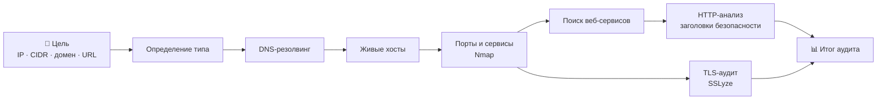

<div align="center">

```
██╗      █████╗ ██╗███╗   ██╗
██║     ██╔══██╗██║████╗  ██║
██║     ███████║██║██╔██╗ ██║
██║     ██╔══██║██║██║╚██╗██║
███████╗██║  ██║██║██║ ╚████║
╚══════╝╚═╝  ╚═╝╚═╝╚═╝  ╚═══╝
```

# L.A.I.N.

**Logical Automated Intrusion Net-scanner**

Одна команда — и от домена, IP или подсети вы получаете карту открытых портов, сервисов, веб-уязвимостей и состояния TLS.


</div>

---

## 💡 О проекте

Аудит безопасности обычно превращается в ручную цепочку: `nmap` → найти веб-порты → `curl -I` → проверить сертификат → собрать всё в одно место. **L.A.I.N.** автоматизирует эту цепочку и объединяет результаты разных инструментов в единую типизированную модель с аккуратным выводом в терминале.

Вы указываете цель — L.A.I.N. сам определяет её тип, находит живые хосты, сканирует порты, распознаёт сервисы и их версии, находит веб-сервисы и анализирует их защиту.

## ✨ Возможности

| | Что умеет |
|---|---|
| 🎯 **Умный разбор цели** | Автоматически определяет, что вы передали: IP, подсеть (CIDR), домен или URL |
| 🌐 **DNS-резолвинг** | Преобразует домены и URL в IP-адреса, раскрывает CIDR-диапазоны в список хостов |
| 📡 **Обнаружение хостов** | Отсеивает недоступные адреса и оставляет только живые узлы |
| 🔍 **Сканирование портов и сервисов** | Открытые порты, имя сервиса, продукт, версия и CPE через Nmap |
| 🕸️ **Поиск веб-сервисов** | Сам выбирает из результатов HTTP/HTTPS-порты (80, 443, 8080, 8443 и нестандартные) |
| 🛡️ **HTTP-анализ безопасности** | Проверка заголовков безопасности: CSP, HSTS, Referrer-Policy, X-Content-Type-Options, X-Frame-Options, раскрытие технологий сервера |
| 🔐 **TLS-аудит** | Отдельная команда `lain tls` на базе SSLyze для проверки TLS-конфигурации хоста по выбранным портам |
| ⚡ **Асинхронность** | HTTP-анализ всех найденных веб-сервисов выполняется параллельно (`asyncio`) |
| 🧩 **Типизированные данные** | Результаты нормализуются в Pydantic-модели: `Target`, `Host`, `Port`, `Service` |
| 🎨 **Красивый вывод** | Панели, таблицы и цветовая индикация на Rich |

## 🔄 Как это работает



## 🚀 Быстрый старт

### Требования

- Python **3.12+**
- [uv](https://docs.astral.sh/uv/) — менеджер пакетов
- [Nmap](https://nmap.org/download.html), установленный в системе

### Установка

```bash
git clone https://github.com/Fenxozepxm2/L.A.I.N..git
cd L.A.I.N.
uv sync
```

## 🕹️ Использование

### `lain scan <target>` — полный аудит цели

```bash
lain scan nmap.scanme.org      # домен
lain scan 192.168.1.10         # IP-адрес
lain scan 192.168.1.0/24       # подсеть
lain scan https://example.com  # URL
```

Пример вывода:

```
╭──────────────────────╮
│ L.A.I.N.             │
│ Network Security Audit │
╰──────────────────────╯

Цель: nmap.scanme.org

1. Определение сетевых адресов
[*] DNS resolution: nmap.scanme.org
[+] Получено адресов: 1

2. Обнаружение активных хостов
[+] Активных хостов: 1

3. Сканирование портов и сервисов
╭─────────────── Nmap ───────────────╮
│ Хостов                       1     │
│ Активных                     1     │
│ Открытых портов              4     │
│ Идентифицированных сервисов  3     │
╰────────────────────────────────────╯

45.33.32.156 (scanme.nmap.org) ● up
  Открытые порты: 22, 80, 9929, 31337
   Порт  Сервис                  CPE
     22  ssh (OpenSSH 6.6.1p1)   cpe:/a:openbsd:openssh:6.6.1p1
     80  http (Apache httpd 2.4.7)  cpe:/a:apache:http_server:2.4.7

4. Анализ HTTP/HTTPS
[+] HTTP-анализов: 1

╭──────────── Итог аудита ────────────╮
│ Веб-сервисов   1                    │
╰─────────────────────────────────────╯
✓ Аудит завершён
```

### `lain tls <hostname> <ports...>` — аудит TLS

```bash
lain tls badssl.com 443
lain tls example.com 443 8443
```

Принимает как чистый хост, так и URL (`https://site.com`, `site.com:443`) — имя хоста будет извлечено автоматически.

### Прочие команды

```bash
lain --help      # помощь)
lain version     # версия L.A.I.N.
```

## 🧱 Технологии

| Слой | Инструменты |
|---|---|
| Язык | Python 3.12, `asyncio` |
| CLI и вывод | Typer, Rich |
| Модели данных | Pydantic v2 |
| Сканирование сети | Nmap (`python-nmap`) |
| TLS-анализ | SSLyze |
| HTTP | httpx |
| Окружение | uv |

## 🗂️ Структура проекта

```
L.A.I.N./
├── __main__.py          # CLI: команды scan, tls, version
├── pydantic_models/     # Типизированные модели: Target, Host, Port, Service...
├── src/
│   ├── services/        # IP-резолвинг, сканирование Nmap, TLS-анализ, парсер результатов
│   └── web_analize/     # HTTP-анализатор и правила безопасности
└── pyproject.toml
```

---


